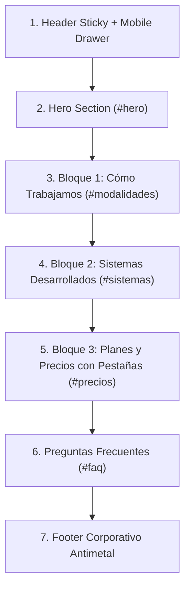

# Especificación y Estructura de la Landing Page — Kodiquett (`v2/index.html`)

Este documento detalla la arquitectura de información, el propósito comunicativo, el sistema de diseño (**Estilo Antimetal**), la paleta de colores, la tipografía y el desglose sección por sección de la página principal ubicada en `F:\CarWash\v2\index.html`.

---

## 1. ¿Qué quiere dar a conocer a los usuarios? (Propósito y Propuesta de Valor)

La landing page presenta a **Kodiquett**, una empresa colombiana de tecnología y desarrollo de software (fundada en Cali en septiembre de 2025, con cobertura nacional), cuyo mensaje central es:

> **«Creamos el software que tu empresa necesita»**

### Mensajes clave que transmite al visitante:
1. **Doble modalidad de solución (Claridad comercial inmediata):**
   - **Modalidad 01 — Sistemas Propios (SaaS / Listos para operar):** Plataformas ya construidas y probadas en operaciones reales para industrias específicas, listas para usarse desde el primer día sin meses de espera y con tarifas fijas transparentes en pesos colombianos (COP).
   - **Modalidad 02 — Desarrollo de Software a la Medida:** Creación desde cero de plataformas web o aplicaciones móviles para empresas con flujos de trabajo particulares, inventarios especializados o integraciones con pasarelas de pago (Wompi, Bold, PayU) y ERPs.
2. **Demostración de capacidad real con productos propios activos:**
   - **Kodiquett Salud (Sector Clínico/Odontológico):** Plataforma en la nube con agenda médica, confirmación por WhatsApp en un clic, historia clínica, odontograma digital interactivo y presupuestos en PDF.
   - **Kodiquett Wash (Sector Automotriz/Autolavados):** Software 100% offline/cloud para registro ultrarrápido por placa, tablero Kanban de bahías con tiempos en vivo, liquidación de comisiones a operarios y tickets térmicos POS.
3. **Eliminación de fricciones y objeciones comunes:**
   - **Transparencia de precios:** Muestra abiertamente los precios en COP tanto en suscripción mensual/anual (*Kodiquett Salud*) como en pago único vitalicio o combo con hardware (*Kodiquett Wash*).
   - **Propiedad intelectual para el cliente:** En los desarrollos a la medida, la empresa cliente es **100% dueña del código fuente**, sin cobros de licenciamiento perpetuo.
   - **Cercanía y soporte humano:** Atención directa por ingenieros de software desde Cali para toda Colombia vía WhatsApp, sin intermediarios ni bots complejos.

---

## 2. Paleta de Colores (Sistema de Diseño "Antimetal")

El sistema visual está definido en `v2/css/main.css` y `v2/css/components.css` bajo una estética **Antimetal**: fondos limpios de alto contraste (`#FFFFFF` y `#FAFAFA`), bordes técnicos milimétricos, tipografía oscura profunda y un acento **Verde Lima eléctrico (`#D5F509`)** de alta energía.

### 2.1. Colores de Acento (Brand Lime)
| Variable CSS | Valor Hex / RGBA | Uso en la Interfaz |
| :--- | :--- | :--- |
| `--lime-primary` | `#D5F509` | Color insignia de marca. Botones primarios (`.btn-lime`), palabras destacadas en el Hero (`.text-lime`), badges destacados (`MÁS POPULAR`), placas de vehículos y aura ambiental del Hero. |
| *Hover Botón Lime* | `#C7E608` | Estado `:hover` de los botones principales `.btn-lime`. |
| `--lime-dark` | `#889A16` | Acento contrastado (verde oliva) para íconos de check (`.bento-features i`), bordes activos y detalles sobre fondos claros. |
| `--lime-light` | `#E1F756` | Variante luminosa del verde lima para lavados suaves. |
| `--lime-wash` | `rgba(213, 245, 9, 0.12)` | Fondo traslúcido para etiquetas superiores (`.section-tag`) y estados activos/seleccionados. |
| `--lime-glow` | `rgba(213, 245, 9, 0.35)` | Resplandor difuminado y sombras de acento. |

### 2.2. Textos y Tintas Oscuras
| Variable CSS | Valor Hex | Uso en la Interfaz |
| :--- | :--- | :--- |
| `--ink-black` / `--text-primary` | `#111319` | Tinta principal para títulos (`h1`–`h6`), textos de botones `.btn-lime`, fondo de botones `.btn-dark` y bordes de tarjetas destacadas (`.featured`). |
| `--deep-charcoal` | `#252736` | Superficies oscuras secundarias, estado `:hover` de `.btn-dark` y divisores de alta densidad. |
| `--text-secondary` | `#4B5162` | Color base del `body` y listas de características (`.bento-features li`). |
| `--slate-gray` / `--text-muted` | `#747484` | Texto secundario, subtítulos, descripciones de tarjetas, enlaces de navegación en reposo y metadatos. |

### 2.3. Fondos, Superficies y Bordes
| Variable CSS / Color | Valor Hex | Uso en la Interfaz |
| :--- | :--- | :--- |
| `--bg-page` / `--bg-surface` | `#FFFFFF` | Fondo principal de la página, tarjetas Bento, tarjetas de precios, cabecera (con `rgba(255, 255, 255, 0.94)` y `backdrop-filter: blur(12px)`) y pie de página. |
| *Fondo Alterno de Sección* | `#FAFAFA` | Fondo gris cálido ultraligero para alternar secciones (`#modalidades` y `#precios`). |
| `--bg-subtle` | `#F9FAFB` | Superficies internas de contenedores de imágenes (`.card-img-wrap`) y estados `:hover` de botones outline/dropdowns. |
| *Contenedor de Pestañas* | `#F3F4F6` | Fondo del selector de pestañas de precios (`.tabs-industry`). |
| `--border-subtle` | `#E5E7EB` | Borde técnico estándar de `1px` para tarjetas, divisores de sección, header y acordeón de FAQ. |
| `--border-slate` | `#A9B0BF` | Borde medio para el estado `:hover` de tarjetas Bento, tarjetas de precios y botones `.btn-outline`. |

### 2.4. Colores Semánticos Adicionales
- **Verde Esmeralda Ahorro Anual (`#047857`):** Usado en las tarjetas de precios de *Kodiquett Salud* para resaltar el descuento por pago anual.
- **Verde Oficial WhatsApp (`#25D366`):** Ícono de WhatsApp en el bloque comercial del Footer.

### 2.5. Sombras y Radios de Borde
- **Sombras:**
  - `--shadow-sm`: `0 1px 2px rgba(17, 19, 25, 0.05)`
  - `--shadow-card`: `0 4px 16px -2px rgba(17, 19, 25, 0.05), 0 1px 3px rgba(17, 19, 25, 0.02)`
  - `--shadow-float`: `0 24px 48px -12px rgba(17, 19, 25, 0.09), 0 0 0 1px rgba(229, 231, 235, 0.8)`
  - `--shadow-lime`: `0 4px 20px rgba(213, 245, 9, 0.3)`
- **Radios de Borde:**
  - `--radius-xs`: `22px` (píldoras para botones, tags, selector de pestañas y miniaturas de tarjetas)
  - `--radius-sm`: `6px`
  - `--radius-md`: `10px` (tarjetas Bento, tarjetas de precios, imagen isométrica del Hero)
  - `--radius-lg`: `16px`
  - `--radius-full`: `9999px`

---

## 3. Tipografía e Iconografía

El proyecto carga tres familias tipográficas desde **Google Fonts** y utiliza **Font Awesome 6.4.0** para la iconografía.

### 3.1. Familias Tipográficas
1. **Títulos y Display (`--font-display`):**
   - **Fuente:** `'Plus Jakarta Sans', system-ui, -apple-system, sans-serif`
   - **Pesos cargados:** `600`, `700`, `800`, `900`
   - **Características:** `line-height: 1.12`, `letter-spacing: -0.035em` (y `-0.04em` en el Hero). Aporta carácter tecnológico, geométrico y contundente en titulares, nombres de productos y cifras de precios.
2. **Cuerpo y UI (`--font-body`):**
   - **Fuente:** `'Inter', system-ui, -apple-system, sans-serif`
   - **Pesos cargados:** `400`, `500`, `600`, `700`
   - **Características:** Tamaño base `16px` (`1rem`), `line-height: 1.6`, `-webkit-font-smoothing: antialiased`. Optimizada para lectura fluida en párrafos, menús de navegación, botones y listas de funcionalidades.
3. **Datos Técnicos y Etiquetas (`--font-mono`):**
   - **Fuente:** `'JetBrains Mono', monospace`
   - **Pesos cargados:** `500`, `600`, `700`
   - **Características:** `font-variant-numeric: tabular-nums`, `text-transform: uppercase`, `letter-spacing: 0.08em` a `0.1em`. Se emplea en las etiquetas técnicas tipo consola (ej. `KODIQUETT // DESARROLLO DE SOFTWARE & SAAS`, `MODALIDAD 01 // SISTEMAS PROPIOS (SAAS)`) y badges.

### 3.2. Escala Tipográfica Principal
- **Título Hero (`.hero-title`):** `clamp(2.5rem, 4.4vw, 3.85rem)` | Peso `900` | Tracking `-0.04em`
- **Títulos de Sección (`.section-title`):** `clamp(2rem, 3.4vw, 2.85rem)` | Peso `900`
- **Títulos de Tarjetas Bento / Modalidades (`.bento-title`):** `1.4rem` (`22.4px`) | Peso `800`
- **Títulos de Planes de Precios:** `1.35rem` (`21.6px`) | Peso `800`
- **Cifras de Precios:** `1.6rem` (`25.6px`) | Peso `900` (`Plus Jakarta Sans`)
- **Subtítulo Hero (`.hero-subtitle`):** `1.15rem` (`18.4px`) | Color `--slate-gray`
- **Descripción de Sección (`.section-desc`):** `1.05rem` (`16.8px`) | Color `--slate-gray`
- **Párrafos de Tarjetas y Listas:** `0.85rem` – `0.925rem` (`13.6px` – `14.8px`)
- **Etiquetas Monospace (`.section-tag`, `.bento-tag`):** `0.7rem` – `0.725rem` (`11.2px` – `11.6px`) | Peso `700`

---

## 4. Estructura General de la Web (`v2/index.html`)

La página utiliza un contenedor principal `.container` de `max-width: 1200px` (y `.container-narrow` de `max-width: 820px` para las preguntas frecuentes), estructurado en **7 bloques semánticos**:

### 4.1. Cabecera Principal (`<header>`) y Menú Móvil (`.mobile-nav-drawer`)
- **Comportamiento:** Barra superior fija (`position: sticky; top: 0; z-index: 100; height: 72px`) con efecto glassmorphism (`backdrop-filter: blur(12px)`).
- **Elementos en Desktop:**
  - **Logo izquierda:** Imagen `img/logoKodiquettSinFondo.png` (`85x85px`) que enlaza a `index.html`.
  - **Navegación central (`.nav-links`):**
    1. Dropdown interactivo **«Nuestros Sistemas»** (`#systemsDropdownToggle`) con enlaces a `salud.html` (*Kodiquett Salud*) y `wash.html` (*Kodiquett Wash*).
    2. Ancla interna `Cómo Trabajamos` (`#modalidades`).
    3. Enlace a página `Software a la Medida` (`custom.html`).
    4. Enlace a página `Sobre Nosotros` (`nosotros.html`).
    5. Ancla interna `Precios` (`#precios`).
  - **Acción derecha:** Botón principal `.btn-lime` **«Hablar con Asesor»** con ícono de WhatsApp (`data-wa="general"`), más el botón hamburguesa `.mobile-toggle` (visible en pantallas `<= 960px`).
- **Drawer Móvil (`#mobileNavDrawer`):** Menú lateral deslizable a pantalla completa para móviles con enlaces directos a todas las páginas y secciones, botón de WhatsApp al 100% de ancho y pie con ubicación (`Cali, Colombia`) y correo dinámico (`azuladev93@gmail.com`).

### 4.2. Sección Hero (`#hero`)
- **Layout:** Cuadrícula asimétrica de 2 columnas (`.hero-grid` con proporción `1.15fr 0.85fr` en desktop, 1 columna en móvil).
- **Columna Izquierda (Editorial y Conversión):**
  - **Tag técnico:** `KODIQUETT // DESARROLLO DE SOFTWARE & SAAS`
  - **H1 Principal:** *«Creamos el **software** que tu **empresa** necesita»* (con las palabras *software* y *empresa* resaltadas en `--lime-primary`).
  - **Subtítulo:** Explica en una frase las dos líneas de negocio (soluciones propias sectoriales + software a la medida).
  - **Doble CTA (`.hero-actions`):**
    - Primario (`.btn-lime`): `Ver Sistemas Desarrollados →` (ancla a `#sistemas`).
    - Secundario (`.btn-outline`): `Cotizar Software a Medida` (enlace a `custom.html`).
- **Columna Derecha (Showcase Visual Isométrico):**
  - Muestra la ilustración `img/Panel de análisis isométrico KODIQUETT.png` sobre un escenario con animación física continua de flotación (`heroFloat` de 5s) y un aura trasera verde lima pulsante (`heroGlowPulse` de 6s con `blur(40px)`). Respeta `prefers-reduced-motion`.

### 4.3. Bloque 1: Cómo Trabajamos (`#modalidades`)
- **Propósito:** Guiar al usuario para que identifique cuál de los dos modelos de negocio de Kodiquett se adapta a su empresa.
- **Estilo de sección:** Fondo `#FAFAFA` con bordes superior e inferior `--border-subtle`.
- **Encabezado:** Título *«Dos formas de trabajar con Kodiquett»* y descripción introductoria.
- **Grid comparativo (`1fr 1fr`, máx. `980px`):**
  1. **Tarjeta 1 — `MODALIDAD 01 // SISTEMAS PROPIOS (SAAS)` ("Sistemas listos para operar"):**
     - Borde sutil, enfoque en implementación inmediata, funcionalidades probadas y tarifas fijas en COP.
     - CTA `.btn-outline`: `Ver Sistemas Desarrollados ↓` (`#sistemas`).
  2. **Tarjeta 2 — `MODALIDAD 02 // DESARROLLO A LA MEDIDA` ("Desarrollo de software a la medida"):**
     - Destacada con borde grueso de `2px solid var(--text-primary)` y sombra flotante (`--shadow-float`).
     - Enfoque en diseño exacto para procesos propios, integración con pasarelas (Wompi, Bold, PayU) / ERPs y entrega completa del código fuente.
     - CTA `.btn-lime`: `Conocer Desarrollo a la Medida →` (`custom.html`).

### 4.4. Bloque 2: Vitrina de Sistemas Desarrollados (`#sistemas`)
- **Propósito:** Presentar los productos propios de Kodiquett como casos activos y tangibles.
- **Grid de Productos (`1fr 1fr`, máx. `1040px`):**
  1. **Card 1 — `Kodiquett Salud` (`SECTOR CLÍNICO • PRODUCTO PROPIO`):**
     - Imagen superior: `img/Clínica dental.png` con zoom suave en `:hover`.
     - Resumen: Gestión para consultorios odontológicos y centros médicos en la nube.
     - Checklist: Agenda médica + WhatsApp, Odontograma digital interactivo, Presupuestos por fases y facturación en PDF.
     - Doble botón inferior: `Ver Detalles y Simulador →` (`salud.html`) y botón WhatsApp `Probar Salud` (`data-wa="salud"`).
  2. **Card 2 — `Kodiquett Wash` (`SECTOR AUTOMOTRIZ • PRODUCTO PROPIO`):**
     - Imagen superior: `img/lavado automotriz-2.png`.
     - Resumen: Software para autolavados de carros, motos y detailing sin depender de internet.
     - Checklist: Registro ultrarrápido por placa, Tablero Kanban de bahías en vivo, Liquidación de comisiones y tickets POS.
     - Doble botón inferior: `Ver Detalles y Tablero →` (`wash.html`) y botón WhatsApp `Probar Wash` (`data-wa="wash"`).
- **Banner Horizontal Inferior ("¿Tu negocio pertenece a otro sector?"):**
  - Bloque ancho (`1040px`) que invita a empresas de otras industrias a desarrollar su propio software, con un botón `.btn-dark` hacia `custom.html` (*«Conocer Metodología a Medida →»*).

### 4.5. Bloque 3: Planes y Precios (`#precios`)
- **Propósito:** Ofrecer transparencia comercial separando los esquemas de precios por industria mediante pestañas interactivas controladas por `initPricingSwitcher()` en `js/main.js`.
- **Selector de Pestañas (`.tabs-industry`):**
  - Pestaña 1 (Activa por defecto): `Precios: Kodiquett Salud (Clínicas)` (`#switchPriceSalud`).
  - Pestaña 2: `Precios: Kodiquett Wash (Autolavados)` (`#switchPriceWash`).
- **Vista 1 — `Kodiquett Salud` (`#pricingViewSalud`, modelo de suscripción mensual/anual):**
  - **Plan Esencial (`$ 89.000 COP / mes` | `$ 74.000 COP/mes` anual):** Para consultorio independiente (1 doctor, 1 secretaria, hasta 1.000 pacientes, agenda e historia clínica).
  - **Clínica Pro — MÁS POPULAR ⭐ (`$ 179.000 COP / mes` | `$ 149.000 COP/mes` anual):** Tarjeta destacada (`.featured`). Hasta 4 doctores, auxiliares y pacientes ilimitados, 25 GB, odontograma interactivo evolutivo, métricas HUD y soporte prioritario.
  - **Plan Élite (`$ 329.000 COP / mes` | `$ 274.000 COP/mes` anual):** Corporativo y multi-sede (hasta 10 doctores, almacenamiento ilimitado, odontograma/ortodoncia/endo/periodontal, migración asistida y capacitación).
- **Vista 2 — `Kodiquett Wash` (`#pricingViewWash`, modelo de pago único):**
  - **Bahía Express (`$ 210.000 COP / Único`):** Licencia vitalicia 1 PC caja + hasta 2 celulares en patio, registro por placa, Kanban, comisiones, 100% offline.
  - **Autolavado Pro — MÁS POPULAR ⭐ (`$ 350.000 COP / Único`):** Tarjeta destacada (`.featured`). Dispositivos móviles ilimitados, sincronización Cloud para el administrador, avisos WhatsApp en 1 clic, personalización con logo y 6 meses de soporte prioritario.
  - **Llave en Mano (`$ 590.000 COP / Único`):** Hardware + Software. Incluye todo el Plan Pro + Impresora térmica POS 58mm (USB/BT) + 5 rollos térmicos + instalación (remota o presencial en Cali) + 6 meses de garantía en impresora y 12 meses de soporte VIP.
- **Módulo Inferior de Cotización a Medida:**
  - Tarjeta horizontal (`max-width: 920px`) para `PROYECTOS ESPECIALES A MEDIDA`, ofreciendo presupuestos por hitos y consultoría técnica inicial de 30 minutos sin costo, con botones hacia `custom.html` y WhatsApp (`data-wa="custom"`).

### 4.6. Sección de Preguntas Frecuentes (`#faq`)
- **Layout:** Contenedor estrecho (`.container-narrow` de `820px`) para lectura enfocada.
- **Componente:** Acordeón interactivo (`.faq-wrap`, gestionado por `initFaqAccordion()` en `js/main.js`, donde el primer ítem inicia abierto con `.is-open`).
- **Las 4 preguntas clave que resuelve:**
  1. *¿Qué es Kodiquett?* (Posicionamiento como empresa colombiana de software con productos SaaS y desarrollo a medida).
  2. *¿Pueden desarrollar software para una industria diferente?* (Confirmación de alcance multisectorial: logística, comercio, servicios, manufactura).
  3. *¿Dónde opera Kodiquett y cómo se atiende el soporte?* (Operación desde Cali con cobertura nacional y atención directa por ingenieros de software).
  4. *¿Quién es el dueño del código en los proyectos a la medida?* (Garantía de que el cliente es 100% dueño del código fuente sin licencias perpetuas).

### 4.7. Pie de Página (`<footer>`)
- **Layout:** Cuadrícula de 4 columnas (`.footer-grid` con proporción `1.5fr 1fr 1fr 1.2fr` en desktop, adaptable a 2 y 1 columna en pantallas pequeñas).
- **Contenido por columna:**
  1. **Identidad:** Logotipo en verde lima y gris (`32x32px`), nombre **Kodiquett**, reseña de fundación (*Cali, septiembre de 2025*), ubicación y correo electrónico inyectado por JS.
  2. **Sistemas Propios:** Enlaces a `salud.html`, `wash.html` y `#precios`.
  3. **Servicios de Software:** Enlaces a `custom.html`, `nosotros.html`, `#modalidades` y `#faq`.
  4. **Atención Comercial:** Enlace destacado de WhatsApp, cobertura en toda Colombia y horario de atención (*Lunes a Sábado: 8:00 AM - 6:00 PM*).
- **Barra Legal Inferior:** Copyright `© 2026 Kodiquett` y enlaces a `legal-privacidad.html` (*Política de Tratamiento de Datos - Ley 1581*) y `legal-terminos.html` (*Términos del Servicio*).

---

## 5. Comportamiento Interactivo y Scripts (`v2/js/main.js`)

La landing page se apoya en `v2/js/main.js` para centralizar la configuración comercial y las interacciones sin dependencias externas pesadas:
- **Enrutamiento dinámico de WhatsApp (`bindWhatsAppLinks`):** Todos los botones con el atributo `data-wa` (`general`, `salud`, `wash`, `custom`) generan automáticamente el enlace `https://wa.me/573000000000?text=...` con un mensaje personalizado según el producto o servicio de interés.
- **Inyección de correo de contacto:** Rellena automáticamente los elementos `[data-contact-email]` con `azuladev93@gmail.com`.
- **Menú desplegable y Drawer móvil (`initNavDropdown`, `initMobileMenu`):** Control de apertura, cierre y atributos de accesibilidad (`aria-expanded`).
- **Conmutador de precios (`initPricingSwitcher`):** Alterna sin recargar la página entre las tarjetas de precios de *Kodiquett Salud* y *Kodiquett Wash*.
- **Acordeón de preguntas frecuentes (`initFaqAccordion`):** Permite expandir una pregunta a la vez cerrando automáticamente las demás.
